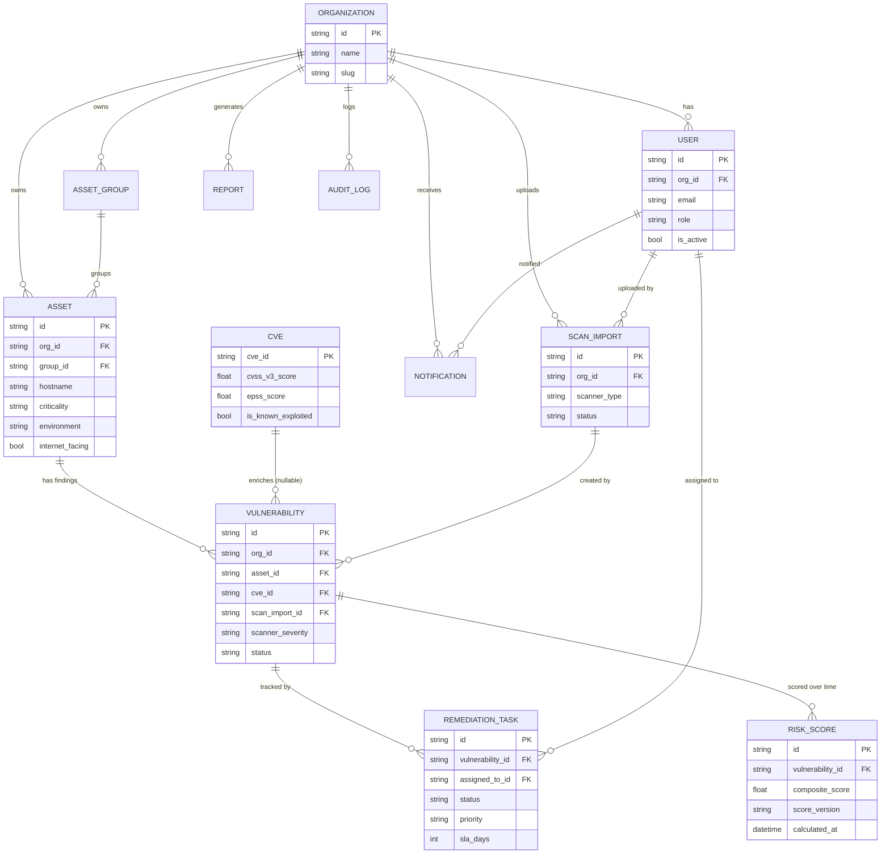

# TriageIQ — Entity Relationship Diagram

Paste this block into https://mermaid.live to render it, or view it directly in any
Markdown viewer that supports Mermaid (GitHub does, natively).

## Key design decisions this diagram makes visible

1. **CVE is the only global (non-tenant-scoped) table.** Every other table has an
   `org_id` foreign key enforcing tenant isolation at the schema level, not just in
   application code — a query that forgets to filter by `org_id` gets caught by
   review/tests rather than silently leaking cross-tenant data.
2. **RiskScore is 1-to-many against Vulnerability**, not 1-to-1. This is what makes
   historical trend charts possible: every recalculation (daily EPSS refresh, KEV
   status change, asset criticality edit) inserts a new row instead of overwriting.
3. **Vulnerability.cve_id is nullable.** Config-only findings (no CVE) still flow
   through the same pipeline, they just don't get CVSS/EPSS/KEV enrichment.
